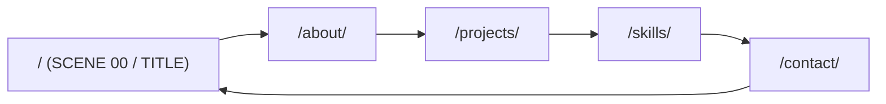

# ページ仕様

## 方針

- 静的サイト (Astro)。実行時 JS は Contact の Email 組み立て (inline script) だけ
- CSS は各ページの `<style>` に inline。外部オリジンへのリクエストは無い
- 見出しフォント (DotGothic16 / Silkscreen) だけセルフホスト。本文は OS のフォント
- 全リンクは末尾スラッシュ付きの絶対パス (Cloudflare Pages が `/x/index.html` を `/x/` に正規化するため)



## ルート

| パス | 画面 | HUD (見出し右) | 画面下のコマンド |
|---|---|---|---|
| `/` | タイトル画面 | なし (左上 `SCENE 00 / TITLE`) | ABOUT / PROJECTS / SKILLS / CONTACT のメニュー |
| `/about/` | セーブデータ画面 | `PLAYER / LV 19` | Title / Next: Projects |
| `/projects/` | セーブファイル一覧 (4 件) | `SAVE DATA / 4 FILES` | Back: About / Next: Skills |
| `/skills/` | ステータス画面 | `STATUS / LV 19` | Back: Projects / Next: Contact |
| `/contact/` | 選択肢ウィンドウ (連絡先 4 件 + その他 2 件) | `LINKS / 06` | Back: Skills / Title |

- 全ページ右上の日付はビルド日 (Asia/Tokyo、`YYYY.MM.DD`)
- 読み込み演出は `.wrap` の子を 1 コマずつ順に表示する。先頭の HUD 帯だけは即表示 (全要素が透明から始まると Chrome が FCP / LCP を記録しないため)
- `/works` は `public/_redirects` で `/projects/` へ 301
- ページタイトルは トップが `Haruworld — Engineer & Designer`、他は `About — Haruworld` の形式

## Contact の Email

`href` と表示文字列を inline script で `h.minemura.0x@gmail.com` に組み立てる。
Cloudflare Email Obfuscation は HTML 中のアドレス文字列に反応して JS を注入するため、dist の HTML にアドレスのリテラルを残さない。
JS 無効時は `h.minemura.0x [at] gmail.com` と表示され、リンク先は `#` のまま。

## 性能予算

キャッシュ空・3G 相当 (300ms / 1.6Mbps)・favicon 除外・3 回中央値。

| 項目 | `/` | 画面 4 ページ |
|---|---|---|
| リクエスト数 | 1 | 4 以下 |
| 転送量 (gzip) | 25KB 以下 | 45KB 以下 |
| first paint | 500ms 以下 | 600ms 以下 |
| load | — | 1,200ms 以下 |

`/` は Latin 2 面のフォントを data URI で HTML に埋め込み 1 リクエストにする。
画面ページは woff2 3 本を preload する。woff2 は `/_astro/` 配下で、`public/_headers` により `immutable` で配信する。

## フォントの再生成

文言を変えると、サブセットに無い文字が OS フォントで描画される。変更したら次を実行する。

```bash
pnpm build
pnpm fonts
pnpm build
pnpm fonts:check
```

- `pnpm fonts` は `dist/` の HTML から文字を集め、`src/assets/fonts/` の woff2 と `charset-*.txt` を更新する
- 元フォントは初回に `node_modules/.cache/font-sources/` へダウンロードされる。sha256 は `scripts/subset-fonts.py` に固定している
- unicode-range の分割 (Latin: U+0000-00FF / U+2014 / U+25B6、それ以外: JP) は `scripts/subset-fonts.py` と `src/components/FontFaces.astro` で一致させる
- 方式の選定理由は [ADR 0001](../adr/0001-heading-font-subsetting.md)

## 計測手順

Chrome (インストール済み) を使う。

```bash
pnpm build
python3 scripts/perf/serve-gzip.py dist 8801 &
pnpm perf http://127.0.0.1:8801/about/ about 300 1.6
```

引数は `<url> <label> [latencyMs] [downMbps]`。出力は JSON で、`runs` に 3 回分、他の項目に中央値が入る。
`serve-gzip.py` は HTML を gzip -9 で返し、全応答に `Cache-Control: no-store` を付ける。
